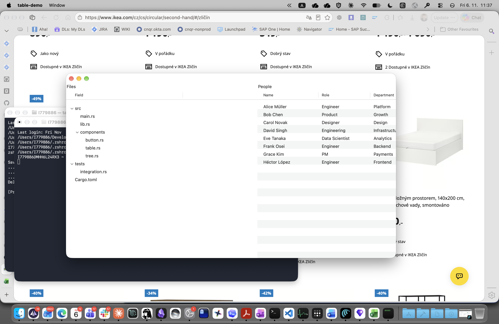

# Table

Native `NSTableView`-backed sortable, resizable table component.

## Usage

```rust
use rn::{table, vstack, window, TableCell, TableColumn, TableModel, TableRow};

let cols = vec![
    TableColumn::new(0, "Name",  160.0).sortable(),
    TableColumn::new(1, "Score",  80.0).sortable(),
    TableColumn::new(2, "Status",100.0),
];
let rows = vec![
    TableRow::new(0, vec![
        TableCell::text("Alpha"),
        TableCell::text("98"),
        TableCell::text("Active"),
    ]),
];
let model = TableModel::new(cols, rows).expect("valid");

let sel_id = rn::HandlerId::new();
rn::on(sel_id, |_| println!("selected"));

let w = window()
    .child(table(model).on_select(sel_id))
    .build();
```

## Props

| Prop | Builder method | Description |
|------|---------------|-------------|
| `TableModelKey` | `table(model)` | The `TableModel` supplying columns and rows |
| `OnSelect` | `.on_select(handler)` | Fires when a row is selected |
| `OnActivate` | `.on_activate(handler)` | Fires on double-click / Enter |

## TableColumn

| Field | Description |
|-------|-------------|
| `id: ColumnId` | Stable column identity |
| `title: String` | Header text shown in the column header |
| `width: f32` | Default column width (points) |
| `min_width: f32` | Minimum resize floor (default 40 pt) |
| `sortable: bool` | Adds `NSSortDescriptor`; clicking header sorts |
| `alignment: TextAlign` | Left / Center / Right (default Left) |

## TableModel

Constructed via `TableModel::new(columns, rows) -> Result<TableModel, String>`.
Returns `Err` if any row's cell count doesn't match the column count.

## Platform notes

- macOS: `NSTableView` (view-based) with alternating row backgrounds, column resizing.
- Windows/Linux: stub (Phase A scope is macOS only).

## Screenshot



## Scale validation (SC-003, SC-004)

Run the demo with 100,000 rows to validate scroll performance and memory behaviour:

```sh
cargo run -p table-demo --features macos -- --rows 100000
```

**SC-003** — scrolling 100k rows should remain smooth throughout (no frames over platform budget).
AppKit's `NSTableView` view-virtualizes cell rendering, so only the visible rows plus a small
buffer are allocated as `NSView` objects at any given time.

**SC-004** — memory note: all 100k `TableRow` structs are heap-allocated in the `Vec<TableRow>`.
The per-frame allocation budget is satisfied by `NSTableView`'s built-in virtualization; total
resident memory grows linearly with total row count, not with visible rows. For datasets larger
than ~1M rows, consider a lazy-loading data source rather than materializing all rows upfront.

## Accessibility (FR-019, SC-008)

Column headers are populated via `NSTableColumn::setTitle`, which AppKit's native
`NSTableHeaderView` exposes as accessibility elements with role `AXColumn` and
the column title as the accessible name. No additional annotations are required.

To verify:

```sh
# Open Accessibility Inspector (Xcode → Open Developer Tool → Accessibility Inspector)
# Focus the table-demo window, hover over a column header.
# The inspector should report:
#   Role: AXColumn
#   Title / Label: <column name> (e.g. "Name", "Role", "Department")
```

Row content is exposed by `NSTableView`'s built-in AX implementation with role `AXRow`.
Selected state is reflected via the platform's own selection AX attributes.
