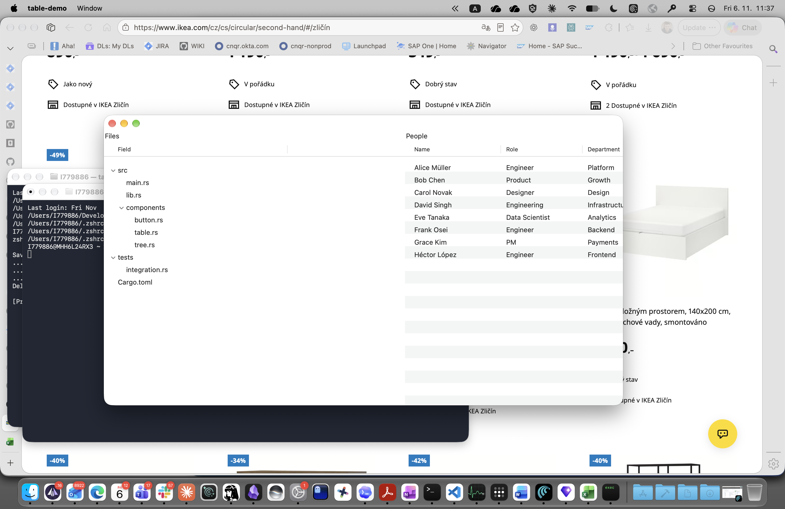

# Tree

Native `NSOutlineView`-backed hierarchical outline / tree component.

## Usage

```rust
use rn::{tree, window, TreeModel, TreeNode};

let model = TreeModel::new(vec![
    TreeNode::branch(1, "src", vec![
        TreeNode::leaf(2, "main.rs"),
        TreeNode::leaf(3, "lib.rs"),
    ]).expanded(),   // pre-expanded on first render
    TreeNode::leaf(4, "Cargo.toml"),
]);

let sel_id = rn::HandlerId::new();
rn::on(sel_id, |_| println!("node selected"));

let w = window()
    .child(tree(model).on_select(sel_id))
    .build();
```

## Props

| Prop | Builder method | Description |
|------|---------------|-------------|
| `TreeModelKey` | `tree(model)` | The `TreeModel` supplying the hierarchy |
| `OnSelect` | `.on_select(handler)` | Fires when a row is selected |
| `OnActivate` | `.on_activate(handler)` | Fires on double-click / Enter |

## TreeNode

| Builder | Description |
|---------|-------------|
| `TreeNode::leaf(id, label)` | Non-expandable node |
| `TreeNode::branch(id, label, children)` | Expandable node with children |
| `.icon(sf_symbol)` | Attach an SF Symbol icon (macOS) |
| `.expanded()` | Pre-expand this node on first render |

## TreeModel

```rust
TreeModel::new(roots: Vec<TreeNode>)
```

Owns the entire node tree. Nodes are value-typed — no cycles possible.

## Platform notes

- macOS: `NSOutlineView` with single-column, source-list-style indentation.
- Windows/Linux: stub (Phase A scope is macOS only).

## Screenshot


